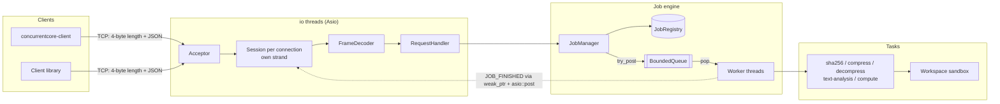

# ConcurrentCore

A multithreaded task processing server in modern C++20. Clients connect over
TCP, submit jobs as length-prefixed JSON, and get results back. Jobs run on a
custom thread pool fed by a bounded producer–consumer queue. The networking is
asynchronous (standalone Asio): each connection is serialized on its own
strand, and worker threads never touch a socket.

```
$ concurrentcore-client submit --type sha256 --file sample.txt --wait
Job 2 submitted (QUEUED)
Job 2
  type:        sha256
  status:      COMPLETED
  queue wait:  0.02 ms
  execution:   0.77 ms
  result:
    {
      "algorithm": "SHA-256",
      "bytes": 29,
      "digest": "3a42709604f508706fa335872e31a4bfe5cf69693e9c29d9109eea610bee755d",
      "file": "sample.txt"
    }
```

## What problem it solves

Backend services often need to accept work from many clients, run it in
parallel without overloading the machine, report progress, cancel work on
request, and shut down without losing accepted jobs. ConcurrentCore is a
compact implementation of that core:

* concurrency is bounded and back-pressure is visible to clients;
* every job has a tracked lifecycle (`QUEUED → RUNNING → COMPLETED | FAILED | CANCELLED`);
* clients are isolated from each other and from slow work;
* shutdown is ordered and bounded.

## Key technical features

* **Custom thread pool.** Fixed `std::jthread` workers; `post` / `try_post` /
  `submit → std::future`; exception-safe workers; graceful or immediate shutdown;
  self-join detection.
* **Generic `BoundedQueue<T>`.** MPMC, mutex plus two condition variables,
  close/drain semantics, documented invariants. It moves from items only on
  success, so ownership is never lost.
* **Job engine.** Per-job state machine under a leaf mutex, exactly-once
  finalization, cooperative cancellation with `std::stop_token`, bounded
  retention, and lock-free (relaxed-atomic) metrics.
* **Asynchronous TCP server.** One strand per connection, an incremental
  4-byte big-endian frame decoder (handles partial reads and coalesced frames),
  size limits enforced from the header, per-connection write back-pressure,
  idle timeouts, a connection limit, push notifications through `weak_ptr`.
* **Five real tasks.**
  * Streaming SHA-256 via Mbed TLS.
  * zlib/gzip compression via zlib, with atomic no-replace output.
  * Decompression with a decompression-bomb guard and corrupt or trailing
    data detection.
  * UTF-8-aware text statistics.
  * A deterministic CPU-bound prime count.
* **Sandboxed file access.** Lexical checks plus symlink-resolving,
  component-wise containment.
* **Tests.** 125 GoogleTest cases (unit, integration against a real server
  over TCP, stress). They pass under GCC, Clang, AddressSanitizer +
  UndefinedBehaviorSanitizer, and libstdc++ debug mode.
* **Reproducible benchmark harness.** In-process and end-to-end scopes;
  p50/p95/p99, CPU utilization, speedup; CSV + Markdown.

## Architecture



More detail: [docs/ARCHITECTURE.md](docs/ARCHITECTURE.md) ·
[docs/CONCURRENCY.md](docs/CONCURRENCY.md) ·
[docs/PROTOCOL.md](docs/PROTOCOL.md) ·
[docs/DESIGN_DECISIONS.md](docs/DESIGN_DECISIONS.md) ·
[docs/BENCHMARKS.md](docs/BENCHMARKS.md) ·
[docs/INTERVIEW_GUIDE.md](docs/INTERVIEW_GUIDE.md)

## Technology stack

| Concern | Choice |
|---|---|
| Language | C++20 (`std::jthread`, `std::stop_token`, `std::latch`, concepts, `std::span`) |
| Build | CMake ≥ 3.25, `FetchContent` with SHA-256-pinned archives |
| Networking | standalone Asio 1.36 |
| JSON | nlohmann/json 3.12 |
| Logging | spdlog 1.16 |
| Hashing | Mbed TLS 3.6 LTS (SHA-256) |
| Compression | zlib 1.3.2 |
| Tests | GoogleTest 1.17 + CTest |
| Benchmarks | custom harness (`benchmarks/bench_main.cpp`) |

## Building

Requirements: a C++20 compiler (GCC ≥ 12, Clang ≥ 16, or MSVC 2022), CMake ≥
3.25, Ninja (optional) and internet access for the first configure. All
dependencies are downloaded and built automatically; nothing needs to be
installed system-wide.

```bash
cmake -S . -B build -G Ninja -DCMAKE_BUILD_TYPE=Release
cmake --build build -j
```

or `scripts/build.sh`. Binaries end up in `build/bin/`:
`concurrentcore-server`, `concurrentcore-client`, `concurrentcore-bench`,
`concurrentcore-example-client`, and the three test executables.

Options: `-DCC_BUILD_TESTS=OFF`, `-DCC_BUILD_BENCHMARKS=OFF`,
`-DCC_BUILD_EXAMPLES=OFF`, `-DCC_WARNINGS_AS_ERRORS=OFF`,
`-DCC_SANITIZER="address;undefined"` or `thread`.

Warnings: project code builds with `-Wall -Wextra -Wpedantic -Wshadow
-Wconversion -Wold-style-cast …` as errors.

## Running the server

```bash
mkdir -p workspace && cp examples/workspace/sample.txt workspace/
./build/bin/concurrentcore-server --workers 8 --workspace workspace
# or: ./build/bin/concurrentcore-server --config config/server.json
```

```
[2026-11-03 16:35:41.869] [info] [tid 35432] ConcurrentCore listening on 127.0.0.1:7878 (io_threads=2, workers=8, queue=1024, workspace=/…/workspace)
```

It binds to `127.0.0.1` by default and warns if bound elsewhere; there is no
authentication. `--help` lists every option (port, io threads, queue capacity,
message size, connection limit, idle timeout, retention, drain timeout, log
level). Ctrl+C or SIGTERM triggers a graceful shutdown: stop accepting work,
let queued jobs finish (up to `--drain-timeout-ms`), cancel the rest, then
flush and close connections.

## Running the client

```bash
C=./build/bin/concurrentcore-client
$C ping
$C submit --type text-analysis --file sample.txt          # prints the job id
$C submit --type sha256 --file sample.txt --wait          # waits for the push event
$C submit --type compress --input sample.txt --format gzip --level 9 --wait
$C submit --type decompress --input sample.txt.gz --output copy.txt --wait
$C submit --type compute --limit 5000000
$C status --job-id 6
$C result --job-id 6
$C cancel --job-id 6
$C wait   --job-id 6        # poll until finished
$C stats
$C help
```

`--json` prints raw protocol responses; `--host`/`--port`/`--timeout-ms` select
the server. Exit codes: 0 success, 1 rejected by server, 2 usage error,
3 connection error. File paths are relative to the server's workspace.

## Example requests and responses

```json
→ {"type":"SUBMIT_JOB","request_id":"r1","task_type":"compute","params":{"limit":1000000},"notify":true}
← {"kind":"response","type":"SUBMIT_JOB","request_id":"r1","ok":true,"result":{"job_id":5,"status":"QUEUED","notify":true}}
← {"kind":"event","type":"JOB_FINISHED","request_id":"r1",
   "data":{"job_id":5,"task_type":"compute","status":"COMPLETED","execution_ms":54.05,"queue_wait_ms":0.02,
           "result":{"algorithm":"prime-count/trial-division","limit":1000000,"prime_count":78498,"largest_prime":999983},
           "error":null, "...":"..."}}

→ {"type":"GET_JOB_RESULT","request_id":7,"job_id":99}
← {"kind":"response","type":"GET_JOB_RESULT","request_id":7,"ok":false,
   "error":{"code":"JOB_NOT_FOUND","message":"job 99 not found (unknown or evicted)"}}

→ {"type":"SUBMIT_JOB","request_id":8,"task_type":"sha256","params":{"file":"../etc/passwd"}}
← {"kind":"response","type":"SUBMIT_JOB","request_id":8,"ok":false,
   "error":{"code":"PATH_NOT_ALLOWED","message":"path '../etc/passwd' rejected: '..' components are not allowed"}}
```

Full schema, all operations, task parameters and the 19 error codes are in
[docs/PROTOCOL.md](docs/PROTOCOL.md).

## Producer–consumer architecture

* **Producers** are the io threads. For `SUBMIT_JOB` they validate the
  parameters, create a `Job`, register it, and `try_post` a closure into the
  bounded queue. They never block. If the queue is full the client gets
  `QUEUE_FULL` immediately, so one overloaded moment cannot freeze the event
  loop.
* **The queue** (`BoundedQueue<UniqueTask>`, 1024 slots by default) bounds
  memory and latency and decouples the two sides.
* **Consumers** are the worker threads. They sleep on a condition variable
  while the queue is empty (no busy-waiting), run one job at a time with no
  lock held, and report completion. A `JOB_FINISHED` event is *posted* to the
  submitting connection's strand, never written from the worker.

## Thread synchronization strategy

* **Leaf locks only.** No code holds two data locks at once (job, registry,
  queue, admission state, session map), so lock-order deadlocks are impossible
  by construction. Lifecycle locks nest strictly outer → inner and are never
  needed by the threads they join.
* **Short critical sections.** Tasks, callbacks, logging and destruction of
  evicted jobs all happen outside locks. Results are shared as
  `shared_ptr<const json>`, so snapshots are O(1).
* **Strands instead of mutexes** for per-connection state.
* **Atomics only for independent counters** (`memory_order_relaxed`). Anything
  needing cross-variable consistency uses a mutex.
* **Lifetimes.** `shared_ptr` jobs survive eviction while queued.
  `weak_ptr` sessions mean finished jobs never touch dead connections. Buffers
  live until their I/O handler runs. Threads are joined before the objects
  they use are destroyed.

The full inventory of shared state, lock ordering, cancellation latencies and
shutdown sequence is in [docs/CONCURRENCY.md](docs/CONCURRENCY.md).

## Testing

```bash
ctest --test-dir build --output-on-failure        # everything
ctest --test-dir build -L unit                    # or: integration, stress
scripts/run_sanitizers.sh address                 # ASan + UBSan (Clang)
scripts/run_sanitizers.sh thread                  # TSan (Linux/macOS)
```

| Suite | Cases | Covers |
|---|---:|---|
| unit | 101 | queue (FIFO, capacity, close/drain, blocking and wake-up, MPMC exactly-once), thread pool (futures, exceptions, concurrency proof, graceful/immediate shutdown, submit-vs-shutdown races, self-join), job state machine (exhaustive transition table, start/cancel race ×2000, concurrent snapshots), registry retention, job manager (failures, cancellation, back-pressure, drain/escalation), tasks (NIST SHA-256 vectors, round trips, bombs, corrupt/truncated/trailing data, overwrite rules), workspace sandbox, frame decoder (byte-by-byte and randomized splits), protocol and request handler |
| integration | 17 | real server on an ephemeral port: all five tasks end-to-end, 12 concurrent clients, 50 pipelined requests correlated by id, byte-at-a-time frames, malformed JSON, oversized frames, mid-frame disconnects, cancellation, `QUEUE_FULL`, connection limit, idle timeout, graceful and immediate shutdown, submissions during shutdown |
| stress | 7 | 240 k-item queue contention, 200 k tasks, 4 000 jobs under back-pressure, 3 000 jobs with 6 000 concurrent cancels, 200 pool and 25 server restart cycles, 32 clients × 40 jobs |

Synchronization in tests uses latches, promises and gates rather than sleeps.

Results on the development machine (Windows 11, i5-1345U), all executed:

| Configuration | unit | integration | stress |
|---|---|---|---|
| GCC 16.2 Release (MinGW-w64 UCRT) | 99 passed, 2 skipped¹ | 17 passed | 7 passed |
| Clang 23.1 Release (llvm-mingw) | see final verification in BENCHMARKS.md | | |
| Clang 23.1 + ASan + UBSan | 99 passed, 2 skipped¹ | 17 passed | 7 passed |
| GCC 16.2 + `_GLIBCXX_DEBUG` / `_GLIBCXX_ASSERTIONS` | 99 passed, 2 skipped¹ | 17 passed | 7 passed |
| ThreadSanitizer | **not run**: TSan does not support Windows targets. Configured in CI for Linux (`.github/workflows/ci.yml`); not executed during development. | | |

¹ The two symlink-escape tests skip on Windows because creating symlinks
requires Developer Mode or admin rights. They run on Linux.

## Benchmarks

```bash
scripts/run_benchmarks.sh --repetitions 5      # writes docs/benchmark_results/*
```

BENCHMARK_TABLE_PLACEHOLDER

## Design trade-offs

* **Reject instead of block** when the queue is full: keeps io threads
  responsive; clients own the retry policy.
* **Per-job mutex** instead of one global lock or lock-free state: consistent
  snapshots with contention limited to a single job.
* **Separate io and worker threads**: slow jobs never delay networking; costs a
  thread hop per completion.
* **Cooperative cancellation**: safe, but a running task stops only at its next
  checkpoint (≤ one 64 KiB chunk).
* **Single FIFO queue**: simple and fair; a single mutex is a ceiling for very
  small tasks.
* **Mbed TLS instead of OpenSSL**: builds everywhere through CMake with no
  system packages.

More in [docs/DESIGN_DECISIONS.md](docs/DESIGN_DECISIONS.md), including how an
include-order ODR violation in Asio's MinGW configuration was tracked down
with gdb.

## Known limitations

* No authentication or TLS; meant for trusted networks (loopback by default).
* In-memory job state; lost on restart.
* No file upload: tasks use files that already exist in the workspace.
* Cancellation cannot interrupt a blocking filesystem read.
* Path sandboxing is check-then-use; a local user able to plant symlinks in the
  workspace could race it (TOCTOU).
* `decompress` accepts single-member gzip/zlib streams only.
* Developed and verified on Windows. The Linux build and the TSan run are
  configured in CI but were not executed during development.

## Future improvements

* Work-stealing per-worker queues; job priorities; per-client quotas.
* TLS and token authentication; streaming upload/download of files.
* Persistent job store and server restart recovery.
* `openat`/`O_NOFOLLOW` descriptor-relative file access to close the TOCTOU gap.
* Prometheus endpoint with latency histograms; structured (JSON) logs.
* Async file I/O (`io_uring` / IOCP) so I/O-heavy tasks do not occupy a worker
  while blocked.

## Repository layout

```
include/concurrentcore/   public headers (concurrency, jobs, tasks, networking, server, client, common)
src/                      implementation + server/client main()
tests/                    unit/, integration/, stress/, support/
benchmarks/               benchmark harness
examples/                 example client program, sample requests, sample workspace
config/server.json        example configuration
scripts/                  build, test, sanitizer, benchmark and demo scripts
docs/                     architecture, concurrency, protocol, benchmarks, design, interview guide
```

## License

MIT. See [LICENSE](LICENSE).
