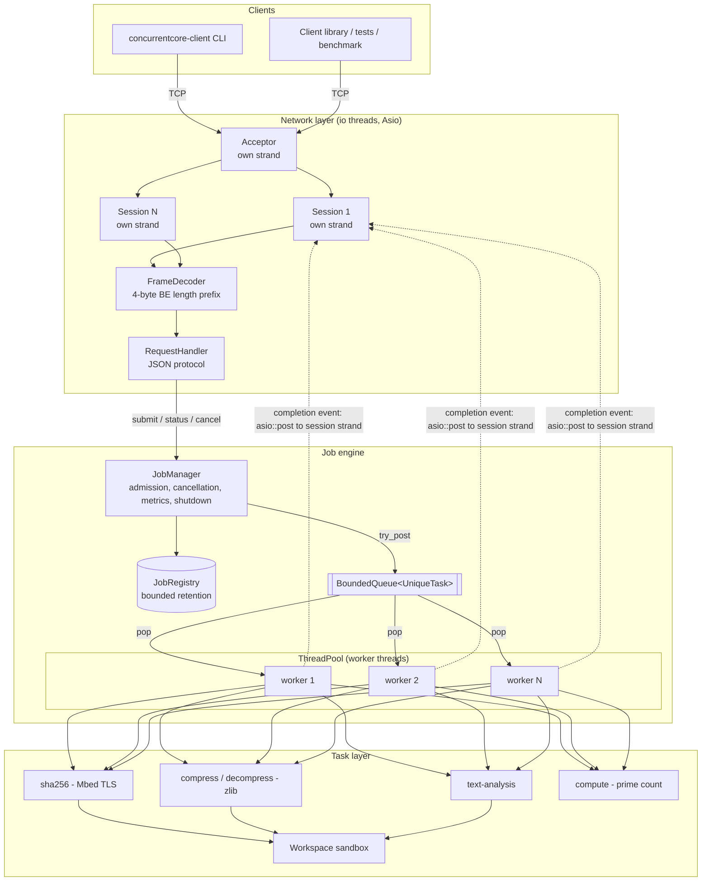

# Architecture

ConcurrentCore is a single-process TCP server. Clients send jobs, a fixed pool
of worker threads executes them, and results are returned to the client that
asked. It is organised as a few layers with one-way dependencies:



## Components

| Component | Files | Responsibility |
|---|---|---|
| `BoundedQueue<T>` | `concurrency/bounded_queue.hpp` | Generic MPMC blocking queue with capacity, close and drain. |
| `UniqueTask` | `concurrency/unique_task.hpp` | Move-only type-erased `void()` (C++20 stand-in for `std::move_only_function`). |
| `ThreadPool` | `concurrency/thread_pool.*` | Fixed set of `std::jthread` workers consuming a `BoundedQueue<UniqueTask>`; `post`, `try_post`, `submit` → `std::future`; graceful / immediate shutdown. |
| `Job` | `jobs/job.*` | One job: immutable spec plus a mutex-guarded state machine, timestamps, result, error, `std::stop_source`. |
| `JobRegistry` | `jobs/job_registry.*` | `id → shared_ptr<Job>` with bounded retention of finished jobs. |
| `JobManager` | `jobs/job_manager.*` | Admission (non-blocking), execution wrapper, cancellation, metrics, drain-then-cancel shutdown. |
| `TaskSpec` / `parse_task_spec` | `tasks/task_spec.*` | Strict parameter validation (unknown keys rejected) into a `std::variant` of typed parameter structs. |
| `Workspace` | `tasks/workspace.*` | Path sandbox: lexical checks plus symlink-resolving containment check. |
| Tasks | `tasks/*_task.cpp` | Streaming SHA-256, zlib/gzip compress and decompress (atomic output, bomb guard), text statistics, prime counting. |
| `FrameDecoder` | `networking/frame.*` | Incremental length-prefix decoder; rejects oversized frames from the header alone. |
| `protocol` | `networking/protocol.*` | Operation names, depth-limited JSON parsing, response/event envelopes. |
| `RequestHandler` | `server/request_handler.*` | Maps requests to `JobManager` calls; independent of sockets, so it is unit-testable. |
| `Session` | `server/session.*` | One connection: strand-serialized reads, writes, timers, back-pressure. |
| `Server` | `server/tcp_server.*` | Owns the `io_context`, acceptor, io threads, sessions and `JobManager`; ordered shutdown. |
| `Client` | `client/client.*` | Synchronous client with per-operation timeouts, request-id matching, event buffering. |
| `concurrentcore-server` | `server/main.cpp` | CLI and config file parsing, logging, signal handling. |
| `concurrentcore-client` | `client/main.cpp` | Command-line client. |
| `concurrentcore-bench` | `benchmarks/bench_main.cpp` | Benchmark harness (CSV + Markdown output). |

## Life of a request

1. **Accept.** The acceptor (on its own strand) accepts a socket bound to a
   *new* strand and creates a `Session`. If the connection limit is reached,
   the session sends `SERVER_BUSY` and closes.
2. **Read.** `Session::do_read` issues one `async_read_some` into a 16 KiB
   buffer. The bytes are fed to the `FrameDecoder`, which yields zero or more
   complete frames, however TCP split them.
3. **Handle.** Each frame goes to `RequestHandler::handle`, which parses the
   JSON (depth-limited), validates the envelope, and dispatches. For
   `SUBMIT_JOB` it validates the task parameters *before* calling
   `JobManager::submit`. This runs on the io thread and never blocks: a full
   queue is reported as `QUEUE_FULL`.
4. **Respond.** The serialized response is framed and appended to the
   session's write queue. One `async_write` is in flight at a time. If the
   client falls behind, reading pauses (back-pressure). If the hard limit is
   exceeded, the connection is dropped.
5. **Execute.** A worker pops the job closure, moves the job to `RUNNING`,
   runs the task with no lock held, and records `COMPLETED`, `FAILED` or
   `CANCELLED`.
6. **Notify.** If the client asked for `notify`, the completion callback holds
   a `weak_ptr<Session>`. It posts the `JOB_FINISHED` event to the session's
   strand. If the client is gone, the event is dropped.
7. **Query.** `GET_JOB_STATUS` / `GET_JOB_RESULT` read an O(1) snapshot. The
   result JSON is shared, not copied.

## Ownership graph

```
main
 └─ Server (stack)
     ├─ ServerConfig            (value, immutable)
     ├─ shared_ptr<const Workspace>  ──shared──► JobManager
     ├─ unique_ptr<JobManager>
     │    ├─ JobRegistry ──► shared_ptr<Job> ◄── queued UniqueTask closure
     │    └─ ThreadPool (declared last → destroyed first)
     │         ├─ BoundedQueue<UniqueTask>
     │         └─ vector<jthread>
     ├─ io_context
     │    └─ pending handlers ──► shared_ptr<Session>
     ├─ acceptor, retry timer
     ├─ RequestHandler (references JobManager)
     ├─ map<id, weak_ptr<Session>>
     └─ vector<thread> io threads
Job ── CompletionCallback ──► EventSink ──► weak_ptr<Session>   (no cycles)
```

## Error handling strategy

* **Client mistakes** (bad JSON, bad parameters, unsafe paths, unknown ids)
  become structured error responses. The connection stays open unless the
  stream itself is unrecoverable (oversized frame).
* **Task failures** are `CoreError` exceptions with a code. The worker
  catches them and records `FAILED` with code and message. Unexpected
  `std::exception`s become `INTERNAL_ERROR`. Nothing escapes a worker:
  fire-and-forget pool tasks that throw are logged and counted.
* **Server-side invariant violations** (e.g. shutdown from a worker thread)
  throw `std::logic_error`.
* **Destructors never throw.** Failures in destructor-driven shutdown are
  logged at `critical`.
* No exception is swallowed silently: every `catch` either converts the
  error into a response or job state, or logs it.

## Configuration

`concurrentcore-server --config config/server.json` loads a JSON file
(comments allowed, unknown keys rejected). Command-line flags override file
values. `validate()` checks ranges before the server starts. See
`config/server.json` for every key.

## Portability

* The primary target is Linux; Windows (MinGW-w64 GCC and Clang) is supported.
  This repository was developed and tested on Windows 11, because no Linux
  environment was available. The Linux CI configuration is provided but was
  not executed during development.
* Platform-specific code is limited to: atomic no-replace rename
  (`link()` vs `MoveFileExW`), wide-character file opening on Windows,
  `SO_REUSEADDR` (POSIX only; on Windows it would allow port hijacking),
  CPU-time measurement in the benchmark, and a MinGW-only Asio configuration
  pin (see DESIGN_DECISIONS.md).
